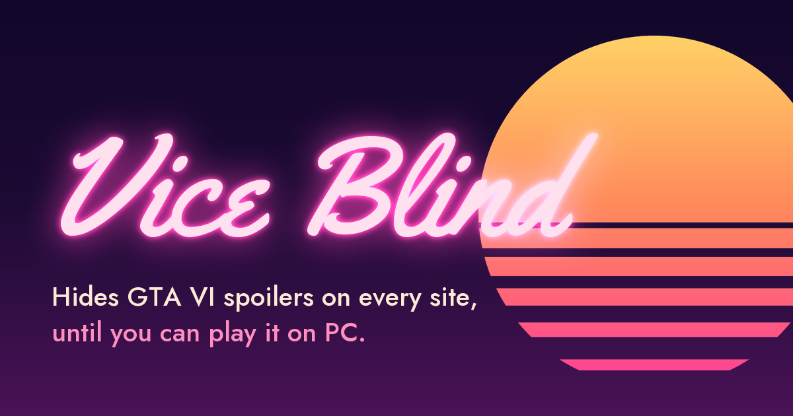
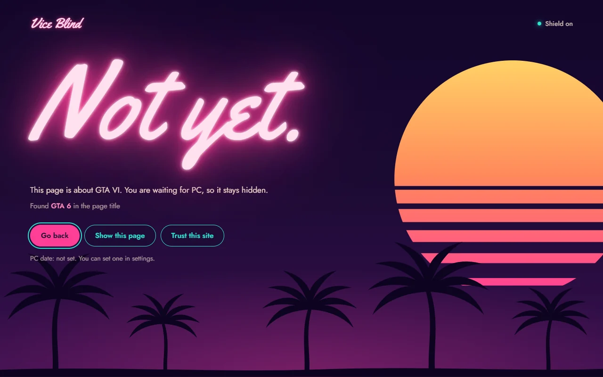
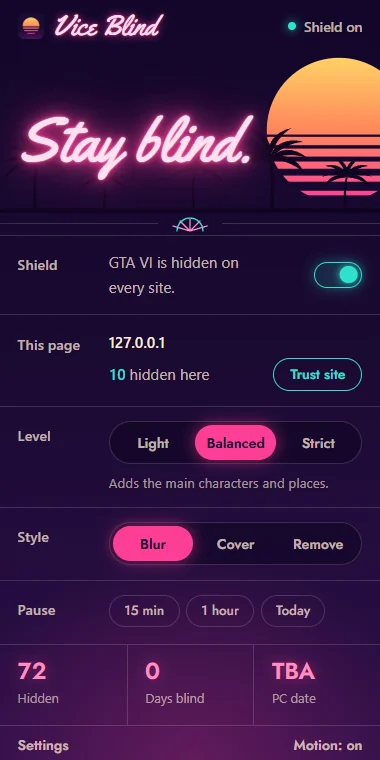
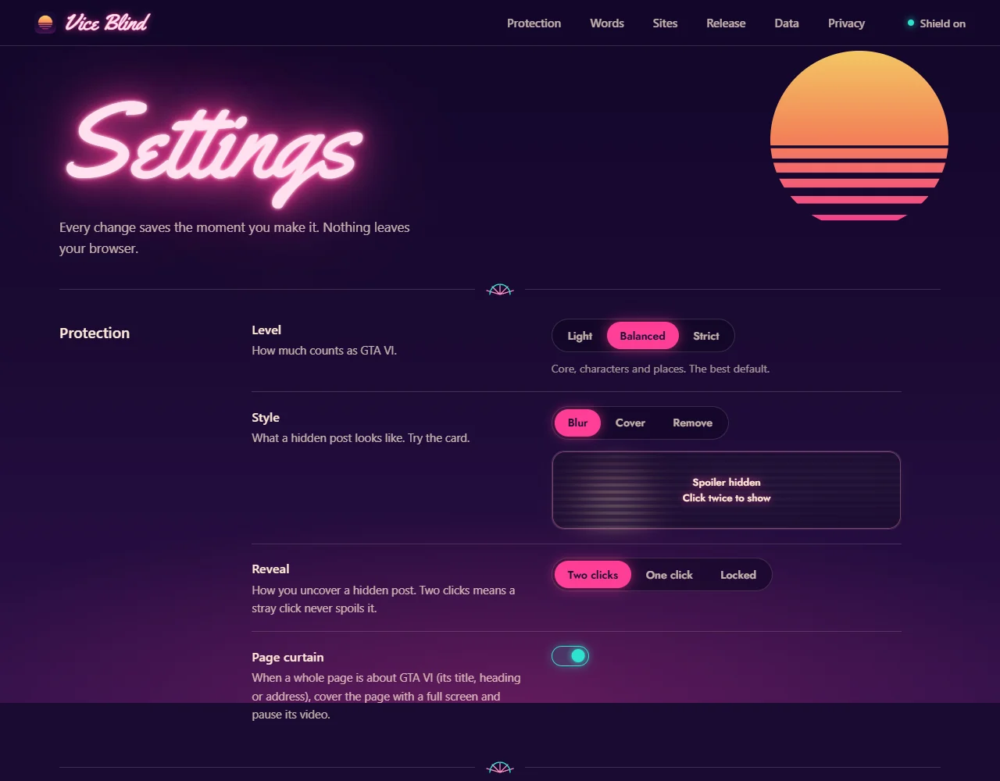

<p align="center"></p>

# Vice Blind: GTA VI spoiler blocker

Website: <https://rocmine.github.io/ViceBlind/> (source in `docs/`) · [Security policy](SECURITY.md) · [MIT licence](LICENSE)

Hides GTA VI posts, videos, thumbnails, headlines and whole pages on every site, so PC players can wait for the PC version without spoilers.
Chrome, Edge, Brave, Opera, Vivaldi and Firefox. No accounts, no analytics, no network requests.

## Screenshots

**The page curtain.** When a whole page is about GTA VI, a neon sign covers it and pauses its video.



**The popup and settings.** Shield on or off, level, style, pause, and your own words, all in one click.

 &nbsp; 

## A note from the author

I made Vice Blind for PC players who don't have a console. GTA VI lands on consoles first, and a lot of us will be waiting a long time for the PC version while every feed fills up with spoilers. I didn't want anyone's story ruined by a thumbnail or a headline, so I built this and made it free and open source.

Thank you to the whole GTA community, and to every PC player who is waiting patiently. The love you put into this series is why this exists. I hope we get GTA VI on PC sooner rather than later. Until then, stay blind.

Find me on Twitch: [twitch.tv/rocmine](https://www.twitch.tv/rocmine)

## What it does

- **Hides cards, not pages.** A matching post, video tile, search result or headline is blurred under a label. Click once to arm, click again to reveal, so a stray click never spoils anything. Also: cover, remove, one-click, or locked.
- **Page curtain.** When a whole page is about GTA VI (title, heading or address), a full-screen neon "Not yet." sign covers it and pauses its video. Go back, show this page, or trust the site.
- **Three levels.** Light (GTA 6 / GTA VI), Balanced (adds characters and places, default), Strict (adds Rockstar, Take-Two, GTA Online).
- **Your own words**, with `*` wildcards, a live "test the filter" box, per-word switches, trusted sites, pause (15 min / 1 h / today), release-day reminder, export and import.
- Works inside shadow DOM (YouTube, Reddit and other web-component sites) and on pages that load content as you scroll.
- Never touches text you are typing (inputs, textareas, editable fields).

## Design

Neon night on Ocean Drive. Midnight plum, flamingo neon (`#ff3e96`), Miami teal (`#2de2d0`), sunset coral, stucco-sand text. Yellowtail (brush script) for the neon sign, Jost for everything else; both self-hosted (Apache-2.0 and OFL licences in `src/assets/fonts/`).

- The mark is a sunset sun cut by blind slats (it is also a window blind). `src/shared/art.js` holds the sun and the palm strip as one source used by the popup, welcome page and curtain; `tools/make_icons.py` draws the icon.
- Hidden cards get plum slat stripes over a blur ("light through blinds"). The blocked page is a neon "Not yet." sign.
- One motion moment: the slats open and the sign flickers on twice (about 1.4 s). The Motion switch in the popup and settings turns it off.

## Install (unpacked, for now)

Build first: `python tools/build.py` (writes `dist/chrome`, `dist/firefox` and two zips).

| Browser | Steps |
|---|---|
| Chrome, Brave, Vivaldi | `chrome://extensions` -> Developer mode -> **Load unpacked** -> `dist/chrome` |
| Edge | `edge://extensions` -> Developer mode -> **Load unpacked** -> `dist/chrome` |
| Opera | `opera://extensions` -> Developer mode -> **Load unpacked** -> `dist/chrome` |
| Firefox (140+) | `about:debugging#/runtime/this-firefox` -> **Load Temporary Add-on** -> `dist/firefox/manifest.json` |

### Firefox says "not verified"?

That is expected until Mozilla signs Vice Blind. Regular Firefox only keeps add-ons signed by Mozilla, and Vice Blind has not been submitted yet. **Do not drag the zip into Firefox or use "Install Add-on From File"**: that is what shows "could not be verified". Use the temporary install above (it lasts until Firefox restarts), or Firefox Developer Edition, Nightly or ESR with `xpinstall.signatures.required` set to `false` in `about:config` (regular Firefox ignores that setting). A signed build will be added to the releases once Mozilla approves it. Steps for signing are in [PUBLISHING.md](PUBLISHING.md).

Chrome and Edge show a "developer mode extensions" banner for unpacked installs. That is also expected until the extension is in their stores.

Safari is not supported (it needs a Mac with Xcode to convert the extension).

## Publishing

- Chrome Web Store / Edge Add-ons / Opera: upload `dist/vice-blind-chrome-1.0.1.zip`.
- Firefox (addons.mozilla.org): upload `dist/vice-blind-firefox-1.0.1.zip`. The manifest already declares `data_collection_permissions: none`. Change `GECKO_ID` in `tools/build.py` if you want a different add-on id.
- Store listing wording: "Not affiliated with Rockstar Games or Take-Two Interactive." The icon is original (window blind), not Rockstar artwork.
- Permissions to justify: `<all_urls>` (the whole point: find GTA VI content on any site), `storage` (settings), `contextMenus` ("Hide selection"), `alarms` (end a pause).

## Develop

```
npm install                 # playwright + web-ext (dev only)
npm test                    # matcher + security unit tests (85)
npm run build
npx web-ext lint --source-dir dist/firefox
VB_CHANNEL=msedge npm run e2e              # loads dist/chrome in a temporary profile, 75 checks + screenshots in test-results/
VB_CHANNEL=msedge node tests/e2e-sites.mjs # live YouTube / Wikipedia smoke test (needs internet)
python tools/build_site.py && VB_CHANNEL=msedge node tests/site.e2e.mjs   # website: assets, CSP, demo, phone width (19 checks)
```

`VB_CHANNEL` picks the browser Playwright drives: `chromium` (default, Playwright's own build), `msedge` or `chrome`. Branded Chrome 137+ ignores `--load-extension`, so use Edge or Playwright's Chromium for automation. On machines where Windows Application Control blocks Playwright's Chromium, use Edge.

The website in `docs/` is served by GitHub Pages (Settings -> Pages -> `main` / `docs`). `tools/build_site.py` copies the shared design files from `src/` into it; `tools/make_og.py` redraws the social card. GitHub Pages cannot send HTTP headers, so the site sets its Content-Security-Policy in a `<meta>` tag (`frame-ancestors` cannot be set that way).

Layout: `src/` is the single source. `tools/build.py` derives both manifests and generates `content/content-css.js` (the stylesheet as a string, injected into shadow roots).

## Known limits

- Text split across block elements ("GTA" in one paragraph, "6" in the next) is not joined; only text split by inline tags is.
- Site card selectors (`src/content/sites.js`) are best-effort; unlisted sites use generic container detection. Verified on YouTube; not verified on logged-in X, Instagram, Facebook, TikTok, Twitch or Discord, or on Reddit.
- Closed shadow roots are scanned where the browser allows it (Chrome and Firefox expose them to extensions).
- Not tested in a real Firefox (no Firefox installed on the dev machine): `web-ext lint` passes with 0 errors, warnings and notices.
